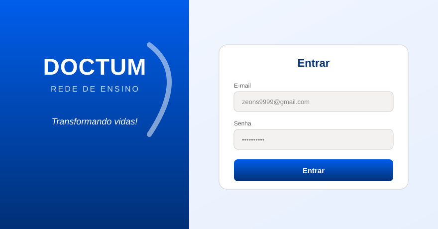
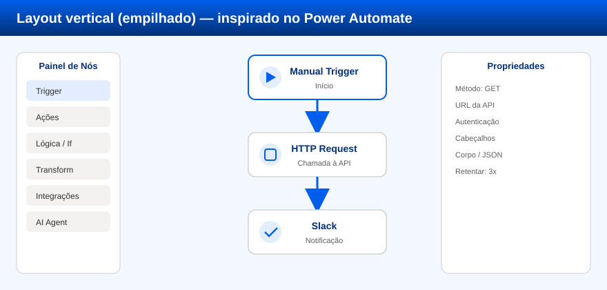
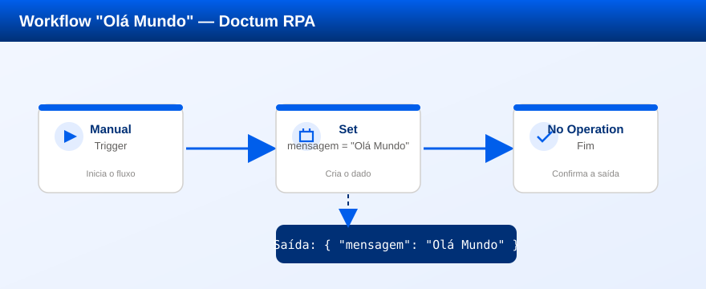

# Doctum — Automação RPA



**Projeto de Pesquisa e Iniciação Científica** sobre automação de processos robóticos (RPA), construído sobre o **n8n** e inspirado visualmente no **Power Automate Desktop**.

---

## 📌 Sumário

- [Sobre o projeto](#sobre-o-projeto)
- [Motivação e objetivos](#motivação-e-objetivos)
- [Tecnologias e linguagens](#tecnologias-e-linguagens)
- [Arquitetura visual](#arquitetura-visual)
- [Nós (conectores) disponíveis](#nós-conectores-disponíveis)
- [Requisitos e instalação](#requisitos-e-instalação)
- [Guia de uso — primeiro workflow "Olá Mundo"](#guia-de-uso--primeiro-workflow-olá-mundo)
- [Licença](#licença)

---

## Sobre o projeto

O **n8n** (pronuncia-se *"nodemation"") é uma plataforma de automação de fluxos de trabalho (workflow automation) de código aberto, licenciada sob **AGPL-3.0**. Ele permite conectar APIs e serviços diferentes através de uma interface visual de "nós" (nodes) ligados por conexões, disparando automações por gatilhos (triggers) como agendamento, webhooks, e-mails ou eventos de outros sistemas.

Este repositório é um **fork personalizado do n8n** com rebranding para a **Rede de Ensino Doctum** e uma série de mudanças **estéticas** que aproximam a experiência de uso do **Power Automate Desktop** da Microsoft:

- **Layout vertical (empilhado):** os nós são organizados de cima para baixo (`rankdir: 'TB'` no algoritmo de layout), tal como no Power Automate, em vez do fluxo esquerda→direita clássico do n8n.
- **Painel de nós à esquerda / menu lateral:** seleção de ações em painel fixo à esquerda e painel de propriedades à direita.
- **Paleta de cores azul:** todo o tema padrão foi ajustado para tons de azul da identidade Fluent Design (a mesma linguagem visual usada pela Microsoft no Power Automate).
- **Logo e identidade Doctum:** ícones, favicon e textos personalizados.

> **Importante:** as mudanças são **estéticas e de organização visual**. Toda a lógica de execução, os conectores, credenciais e o motor de workflow permanecem os do n8n upstream. Isso preserva a compatibilidade com a enorme ecossistema de integrações e permite que o projeto seja usado como base de estudo comparativo entre ferramentas de RPA.

### Diferença para o Power Automate

| Aspecto | Power Automate Desktop | Doctum (n8n personalizado) |
|---|---|---|
| Modelo de licença | Comercial (Microsoft) | Código aberto (AGPL-3.0) |
| Execução | Agente local Windows | Servidor web (n8n) self-hosted |
| Conectores | ~1.000 (ecossistema Microsoft) | 300+ nós nativos + HTTP genérico |
| Linguagem dos fluxos | Power Fx / gravador de ações | Visual (nós) + JavaScript/Code |
| Hospedagem | Microsoft cloud + agente local | Qualquer servidor (Docker ou nativo) |
| Custo | Plano free limitado / premium | Gratuito (self-hosted) |

O valor científico do projeto está justamente em **estudar e comparar** duas abordagens de RPA — a comercial fechada e a open-source — usando o n8n como laboratório, com interface adaptada para facilitar o aprendizado por quem já conhece o Power Automate.

---

## Motivação e objetivos

**Área:** Automação de Processos Robóticos (RPA) e automação de fluxos de trabalho.

**Objetivos gerais**

1. Estudar os fundamentos de RPA e automação de processos através de uma ferramenta real de código aberto.
2. Comparar a experiência de uso, os modelos de execução e a arquitetura do n8n com o Power Automate Desktop.
3. Disponibilizar uma instância auto-hospedada e personalizada para experimentação e ensino.

**Objetivos específicos**

- Mapear os componentes de uma ferramenta de RPA (gatilhos, ações, transformação de dados, tratamento de erros, agendamento).
- Implementar workflows de exemplos (estudo de caso "Olá Mundo" e integrações reais com APIs).
- Analisar requisitos de infraestrutura, segurança de credenciais e escalabilidade.

**Resultados esperados**

- Relatório técnico comparativo entre n8n e Power Automate.
- Biblioteca de workflows de exemplo prontos para uso.
- Material didático (este guia) para iniciação científica em automação.

---

## Tecnologias e linguagens

O projeto é um monorepo gerenciado por **pnpm workspaces**. As linguagens e tecnologias utilizadas no código-fonte:

| Linguagem / Tecnologia | Uso principal | Extensão |
|---|---|---|
| **TypeScript** | Linguagem principal — backend, frontend, todos os nós e a API | `.ts` |
| **JavaScript** | Scripts utilitários, configs e build | `.js`, `.mjs`, `.mts` |
| **Vue 3** | Framework da interface gráfica (editor de workflows, painéis) | `.vue` |
| **SCSS / CSS** | Estilos e tokens de tema (paleta azul Doctum) | `.scss` |
| **JSON** | Configuração de nós, credenciais, package manifests | `.json` |
| **HTML** | Templates e páginas estáticas | `.html` |
| **Handlebars** | Templates de e-mail transacional | `.handlebars` |
| **MJML** | Templates de e-mail responsivos | `.mjml` |
| **Python** | Task runner opcional para acelerar builds/testes | `.py` |

**Principais frameworks e bibliotecas**

- **Vue 3** + **Vite** (frontend e editor visual)
- **Pinia** (gerenciamento de estado)
- **Express** (API REST do backend)
- **TypeORM** + **SQLite** (banco de dados padrão; suporte a Postgres/MySQL)
- **Dagre** (algoritmo de layout de grafos — usado aqui no modo vertical)
- **Vue Flow** (renderização do canvas de nós)
- **LangChain** (`@n8n/nodes-langchain`) — agentes e modelos de IA
- **bcryptjs** (hash de senhas), **jose** (JWT)

---

## Arquitetura visual

A interface foi ajustada para o estilo Power Automate:



**Mudanças-chave**

- **Nós empilhados verticalmente** (448×64 px por padrão), conectados de cima para baixo.
- **Handles (conectores)** distribuídos em percentual ao longo da borda do nó.
- **Painel de nós fixo à esquerda** e **painel de propriedades à direita**.
- **Paleta Fluent azul** como tema padrão (ver `packages/frontend/@n8n/design-system/src/css/_tokens.scss`).

---

## Nós (conectores) disponíveis

O projeto inclui **308 nós** do `nodes-base` (integrações e ações fundamentais) e **20 nós de IA** do pacote `nodes-langchain` (agentes, LLMs e memória).

### Nós de IA (`@n8n/nodes-langchain`)

AI Agent · Auto-fixing Output Parser · Basic LLM Chain · Binary Input Loader · Calculator · Character Text Splitter · Chat · Contextual Compression Retriever · Embeddings AWS Bedrock · Guardrails · LangChain Code · MCP Client · Model · Model Selector · Options · Reranker Cohere · Simple Memory · Tool Executor · vendors · shared

### Nós fundamentais (`n8n-nodes-base`) — por categoria

Os 308 nós estão agrupados nas categorias nativas do n8n:

- **Transform** (107) — manipulação de dados: `Code`, `Set`, `Merge`, `Split In Batches`, `Item Lists`, `IF`, `Switch`, `Filter`, `Aggregate`, `XML`, `JSON`, `HTML Extract`, `Compare Datasets`, `Date & Time`, `Rename Keys`, `Compression`, `Spreadsheet File`, entre outros.
- **Output / Input** (164) — geração e captura de dados: `Webhook`, `HTTP Request`, `Respond With`, `Read/Write Binary File`, `Read PDF`, `Execute Command`, `SSH`, `Email Trigger (IMAP)`, `Send Email`, entre outros.
- **Trigger** (29) — gatilhos de evento/agendamento: `Cron`, `Schedule Trigger`, `Manual Trigger`, `Error Trigger`, `Webhook`, `Email Trigger (IMAP)`, `Local File Trigger`, `SSE Trigger`, entre outros.
- **Bancos de dados** — `MySQL`, `Postgres`, `MongoDB`, `Redis`, `Oracle`, `Microsoft SQL`, `CrateDB`, `QuestDB`, `TimescaleDB`, `Supabase`, `Snowflake`, `Databricks`, `Airtable`, `Google Sheets`, `NocoDB`, `Baserow`, `SeaTable`.
- **Comunicação e notificação** — `Slack`, `Telegram`, `Discord`, `WhatsApp Business Cloud`, `Microsoft Teams`, `Rocket.Chat`, `Mattermost`, `Twilio`, `SMS` (via `seven`, `MessageBird`, `Vonage`, `Plivo`, `Mocean`, `MSG91`).
- **CRM e vendas** — `HubSpot`, `Salesforce`, `Pipedrive`, `Zoho CRM`, `Freshworks CRM`, `Agile CRM`, `ActiveCampaign`, `Keap`, `Copper`, `Monica CRM`, `HighLevel`, `Salesmate`.
- **Marketing e e-mail** — `Mailchimp`, `SendGrid`, `Mailgun`, `MailerLite`, `Brevo`, `Mandrill`, `Mailjet`, `ConvertKit`, `GetResponse`, `Iterable`, `Customer.io`, `Lemlist`, `Emelia`, `Dropcontact`, `E-goi`.
- **Produtividade e gestão** — `Notion`, `Trello`, `Asana`, `ClickUp`, `Monday.com`, `Airtable`, `Coda`, `Jira Software`, `Linear`, `Todoist`, `Confluence`, `Google Drive`, `Dropbox`, `Box`, `Nextcloud`, `SharePoint`, `OneDrive`.
- **E-commerce e pagamentos** — `Shopify`, `WooCommerce`, `Stripe`, `PayPal`, `Paddle`, `Square`, `Razorpay`, `Mollie`, `GoCardless`, `Chargebee`, `QuickBooks Online`, `Xero`, `FreshBooks`, `Invoice Ninja`.
- **Cloud e DevOps** — `AWS Lambda`, `S3`, `Kafka`, `RabbitMQ`, `AMQP`, `MQTT`, `Jenkins`, `CircleCI`, `TravisCI`, `Bitbucket`, `GitHub`, `GitLab`, `Cloudflare`, `Netlify`, `Docker` (via `Execute Command`/`SSH`).
- **Web e scraping** — `HTTP Request`, `GraphQL`, `RSS Read`, `HTML Extract`, `ScrappeR`, `Jina AI`, `Hunter`, `Hunter`, `URL / Scanner`.
- **IA e ML** — `OpenAI`, `Mistral AI`, `Perplexity`, `Jina AI`, `Embeddings`, `Chat`, `Vector Store`, `AI Transform`, `Message an Agent`.
- **Utilitários** — `Sticky Note`, `No Operation, do nothing`, `DebugHelper`, `Stop and Error`, `Set`, `Merge`, `If`, `Switch`, `Wait`, `Limit Wait Time`, `Split In Batches`, `Execute Command`, `Code`, `Function`, `Function Item`, `Workflow Trigger`, `n8n Trigger`.

> A lista completa e detalhada dos 308 nós está em [`docs/nodes-list.md`](docs/nodes-list.md).

---

## Requisitos e instalação

As versões exatas das ferramentas usadas neste projeto estão no arquivo [`requirements.txt`](requirements.txt). Resumo:

| Ferramenta | Versão mínima | Versão usada aqui |
|---|---|---|
| Node.js | ≥ 24.0.0 | 24.22.1 |
| pnpm | ≥ 12.4.2 | 12.15.0 |
| n8n | 2.45.0 (fork) | 2.45.0 |
| SQLite (driver) | — | 5.1.7 |
| Docker (opcional) | ≥ 24.x | — (não usado nesta máquina) |

Existem **duas formas de instalar**: com Docker (recomendado para produção/uso rápido) e sem Docker (desenvolvimento nativo). Cada uma com passos para **Linux** e **Windows**.

### Opção A — Com Docker

#### Linux (Ubuntu/Debian e derivados)

```bash
# 1. Instalar o Docker (se ainda não tiver)
curl -fsSL https://get.docker.com -o get-docker.sh
sudo sh get-docker.sh
sudo usermod -aG docker $USER   # depois, faça logout/login

# 2. Subir a instância do n8n com persistência de dados
docker volume create n8n_data
docker run -d \
  --name doctum-n8n \
  --restart unless-stopped \
  -p 5678:5678 \
  -v n8n_data:/home/node/.n8n \
  -e GENERIC_TIMEZONE="America/Sao_Paulo" \
  -e TZ="America/Sao_Paulo" \
  docker.n8n.io/n8nio/n8n:2.45.0

# 3. Acessar
# Abra http://localhost:5678 no navegador
```

#### Windows (PowerShell, com Docker Desktop)

```powershell
# 1. Instalar o Docker Desktop (https://www.docker.com/products/docker-desktop/)
#    Após instalar e iniciar, confirme:
docker --version

# 2. Subir a instância
docker volume create n8n_data
docker run -d `
  --name doctum-n8n `
  --restart unless-stopped `
  -p 5678:5678 `
  -v n8n_data:/home/node/.n8n `
  -e GENERIC_TIMEZONE="America/Sao_Paulo" `
  -e TZ="America/Sao_Paulo" `
  docker.n8n.io/n8nio/n8n:2.45.0

# 3. Acessar
# Abra http://localhost:5678 no navegador
```

> **Nota sobre a personalização:** a imagem oficial `docker.n8n.io/n8nio/n8n` roda o n8n padrão. Para ver a interface Doctum (paleta azul, layout vertical, logo), você precisa executar a partir do código-fonte deste repositório (Opção B) ou construir sua própria imagem Docker a partir dele (veja abaixo).

#### Construindo a imagem Docker personalizada (Doctum)

```bash
# Na raiz deste repositório
docker build -t doctum-rpa:latest .
docker run -d --name doctum-n8n -p 5678:5678 -v n8n_data:/home/node/.n8n doctum-rpa:latest
```

### Opção B — Sem Docker (execução nativa a partir do código)

#### Linux

```bash
# 1. Pré-requisitos: Git e Node.js 24+
sudo apt update
sudo apt install -y git curl
curl -fsSL https://deb.nodesource.com/setup_24.x | sudo -E bash -
sudo apt install -y nodejs

# 2. Instalar o pnpm (gerenciador de pacotes)
corepack enable
corepack prepare pnpm@12.4.2 --activate

# 3. Clonar o repositório
git clone https://github.com/<SEU_USUARIO>/doctum-rpa.git
cd doctum-rpa

# 4. Instalar as dependências do monorepo
pnpm install --frozen-lockfile

# 5. Compilar os pacotes
pnpm build

# 6. Iniciar o n8n personalizado
pnpm n8n

# 7. Acessar
# Abra http://localhost:5678 e conclua o setup do primeiro usuário
```

#### Windows (PowerShell)

```powershell
# 1. Pré-requisitos: Node.js 24+ (https://nodejs.org) e Git (https://git-scm.com)
node --version   # deve ser >= 24
git --version

# 2. Instalar o pnpm
corepack enable
corepack prepare pnpm@12.4.2 --activate

# 3. Clonar o repositório
git clone https://github.com/<SEU_USUARIO>/doctum-rpa.git
cd doctum-rpa

# 4. Instalar as dependências
pnpm install --frozen-lockfile

# 5. Compilar
pnpm build

# 6. Iniciar
pnpm n8n

# 7. Acessar http://localhost:5678
```

> **Windows — dica de drive:** se o caminho do projeto estiver em uma unidade mapeada ou contiver espaços (ex.: `C:\Users\Meu Usuario\Meu Projeto`), o n8n e o Node podem falhar. Prefira caminhos curtos e sem espaços, ou crie uma letra de unidade (`subst`) para o diretório, como foi feito neste ambiente de estudo.

### Estrutura do banco de dados

Por padrão o n8n usa **SQLite** em `~/.n8n/database.sqlite`. Para produção, recomenda-se **PostgreSQL** configurado via variáveis de ambiente (`DB_TYPE=postgresdb`, `DB_POSTGRESDB_*`).

---

## Guia de uso — primeiro workflow "Olá Mundo"

Este passo a passo cria seu primeiro fluxo, do disparo à saída de dados.

### 1. Acesse e faça login

Abra `http://localhost:5678`, informe o **e-mail** e a **senha** definidos no primeiro acesso e clique em **Entrar**.


### 2. Crie um novo workflow

Na tela inicial, clique em **Create Workflow** (ou `+ Novo Workflow`). Você verá o canvas vazio com o painel de nós à esquerda.

### 3. Adicione um gatilho manual

No painel à esquerda, busque por **"Manual Trigger"** e o arraste (ou clique) para o canvas. Esse nó inicia o fluxo manualmente, quando você clica em **Execute Workflow**.

### 4. Adicione um nó "Set" com a mensagem

Arraste um nó **Set** e conecte-o à saída do Manual Trigger (arraste da borda inferior do gatilho até o nó Set). Na configuração do nó Set:

- **Nome do campo (Name):** `mensagem`
- **Valor (Value):** `Olá Mundo`

Esse nó cria um item de dados com a propriedade `mensagem`.

### 5. (Opcional) Finalize com "No Operation"

Arraste um nó **No Operation, do nothing** e conecte-o à saída do Set. Ele serve como marcador de fim do fluxo e confirma a saída.

O workflow deve ficar com esta estrutura:



### 6. Salve e execute

1. Clique em **Save** (canto superior direito) para salvar o workflow.
2. Clique em **Execute Workflow**. O fluxo roda e cada nó fica verde ao concluir.
3. Clique no nó **Set** para inspecionar a **saída** no painel de propriedades. Você verá:

```json
{
  "mensagem": "Olá Mundo"
}
```

Pronto — você automatizou um processo: um gatilho dispara uma ação que produz um dado. A partir daqui, basta trocar o nó Set por integrações reais (HTTP Request, Slack, banco de dados etc.) para construir automações de verdade.

### Próximos passos sugeridos

- **Webhook:** troque o Manual Trigger por um **Webhook** para receber dados de sistemas externos via HTTP.
- **Agendamento:** use **Schedule Trigger** para rodar o fluxo automaticamente a cada dia/hora.
- **Integração real:** use **HTTP Request** para chamar uma API e **Slack** ou **Send Email** para notificar o resultado.
- **Lógica:** adicione um nó **IF** ou **Switch** para ramificar o fluxo conforme os dados.
- **IA:** experimente o **AI Agent** para classificar, resumir ou gerar conteúdo com modelos de linguagem.

---

## Estrutura do repositório

```
doctum-rpa/
├── packages/
│   ├── cli/                      # Backend n8n (API, execução, credenciais)
│   ├── nodes-base/               # 308 nós fundamentais
│   ├── @n8n/
│   │   ├── nodes-langchain/      # 20 nós de IA
│   │   └── design-system/        # Componentes + tema (paleta azul Doctum)
│   └── frontend/
│       └── editor-ui/            # Editor visual (Vue 3 + Vite)
├── docs/
│   ├── images/                   # Diagramas e telas deste guia
│   └── nodes-list.md             # Lista completa de nós
├── requirements.txt              # Versões das ferramentas
└── README.md                     # Este arquivo
```

---

## Licença

Este projeto é um fork de [n8n](https://github.com/n8n-io/n8n), licenciado sob **GNU Affero General Public License v3.0 (AGPL-3.0)**. Consulte o arquivo [`LICENSE`](LICENSE) para os termos completos.

As personalizações de marca e interface (identidade Doctum, paleta azul, layout vertical) estão incluídas como modificações sobre a base original, mantendo as obrigações de licença do AGPL.
